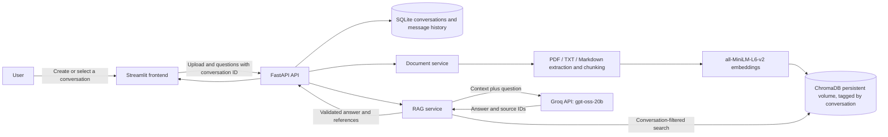

# SmartDocs architecture

Docker Compose builds the same Python image for both application services. The
API owns the ChromaDB and Hugging Face cache volumes. Conversation records and
message history live in SQLite under the ChromaDB data directory. Streamlit
talks to the API through Compose's internal `api` service name; users open
Streamlit on port 8501. All document listing, deletion, and retrieval requests
are scoped to the selected conversation ID.
