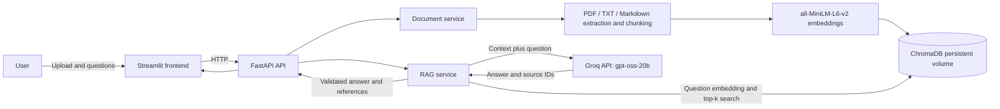

# SmartDocs architecture

Docker Compose builds the same Python image for both application services. The
API owns the ChromaDB and Hugging Face cache volumes. Streamlit talks to the
API through Compose's internal `api` service name; users open Streamlit on port
8501.
